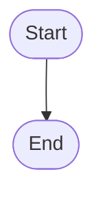

# Plan: [Feature Name]

<!--
  PLAN CONTRACT
  A plan is a specification, not a changelog. Rewrite stale sections instead of adding process
  notes or correction history. Follow token-budget.md for language policy. Diagrams are optional
  for local changes and useful for structural, multi-file, or Protected-Path changes.
-->

<!-- Zone: Context | Diátaxis: explanation | Any producer may fill this zone. | Gate: gal planning-check validates required plan structure. -->
## Goal

[What this change accomplishes and why it matters, stated as a truth that must hold when done]

## Open Questions

- [ ] OQ-01 [H|A|F] — [Open question description] *(raised by: planning)*

<!-- Format: - [ ] OQ-NN [H|A|F] — description *(raised by: command)* -->
<!-- ID format: OQ-NN is a ZERO-PADDED TWO-DIGIT number (OQ-01…OQ-99). THREE-DIGIT form OQ-NNN
     is NEVER valid. Canonical rule: conventions/open-questions.md#id-format. -->
<!-- Class tag (authority class — canonical rule: conventions/open-questions.md):
     H = human authority (taste/value/trust/scope) — only the human closes; an override-able default does NOT close H.
     A = architect authority (technical trade-off) — architect role closes with recorded rationale (doubt → H).
     F = false OQ (one forced answer) — closed with evidence.
     An UNTAGGED OQ defaults to H. -->
<!-- Internalization (OQ-completion gate): when an OQ is resolved, fold the decision into the
     plan body (Approach / Requirements / relevant section) and DELETE the OQ entry, leaving the
     closer-class + rationale in `## Review Results` / git (no `[x] resolved by …` breadcrumbs or
     `see OQ-NN` cross-references). The gate checks that no unresolved question remains. -->

## Plan Chain

- Previous: [plan path or None]
- Next: [plan path or None]

<!-- Zone: Critical Files | Diátaxis: reference | Any producer may fill this zone. | Gate: gal planning-check validates required plan structure. -->
## Files to Create or Modify

- `[path/to/file]` — [purpose]

<!-- Zone: Implementation | Diátaxis: how-to | Any producer may fill this zone. | Gate: gal refining-check checks Tasks and Test Plan. -->
## Requirements

- [ ] R1 — [Observable behavior]
- [ ] R2 — [Observable behavior]

## Diagrams

<!-- Use a terminal-readable flowchart when branching or relationships need explanation. Mermaid
     is also accepted in plan files. Remove this section when a diagram does not aid comprehension. -->

## Approach

### Slice 1: [Action]

- **Covers**: [Requirements or outcomes in this slice]
- **Files**: `path/to/file`
- **Build**: [Concrete implementation work]
- **You see**: [Observable result]
- **Verify**: [How to confirm the slice is complete]

### Slice 2: [Action]

- **Covers**: [Requirements or outcomes in this slice]
- **Files**: `path/to/file`
- **Build**: [Concrete implementation work]
- **You see**: [Observable result]
- **Verify**: [How to confirm the slice is complete]

Prefer charts, tables, diagrams, trees, or flow maps when they reduce reread cost. For branchy
processes, follow the text-flowchart convention.

<!-- Zone: Verification | Diátaxis: how-to | Any producer may fill this zone. | Gate: gal planning-check validates shape; gal refining-check checks Tasks and Test Plan. -->
## Preconditions

<!-- Optional: remove this section when the owner must supply nothing. IDs are PC-NN.
     Every cell is non-empty, not a placeholder, and at most 200 characters outside backticks.
     `Check command` must contain a backticked command. -->

| ID | Requirement | Check command | Expected result | How to satisfy |
| --- | --- | --- | --- | --- |

## Test Plan

Pending.

## Tasks

- [ ] T-NN — [Task description]
  - **Verification Impact**: `{"contract_docs":false,"code_logic":true,"cli_surface":false,"cross_boundary":false}`
  - **Files**:
    - `[path/to/file]`
  - **Change**:
    - **Current**: [Existing behavior or structure]
    - **Change**: [Specific change made by this task]
    - **Removed**: [Behavior or structure removed, or None]
    - **Kept**: [Behavior or structure preserved]
  - **Acceptance**: [Observable pass/fail condition]

<!-- Each task's Change and Acceptance answer applicable questions in conventions/task-quality.md. -->

## Verification Map

| Task | Layer | Proof Command | Expected | Producer | Evidence |
| --- | --- | --- | --- | --- | --- |
| T-NN | unit | `cargo test -p <package>` | [Expected result] | TESTER | [Evidence location] |

<!-- Each task has exactly one Verification Impact JSON object with four Boolean keys. At least one is true. -->
<!-- contract_docs requires contract-doc; code_logic requires unit; cli_surface requires cli; cross_boundary requires integration. -->
<!-- Allowed layers: contract-doc, unit, cli, integration. Include one row per required task/layer pair. -->

## Owner Acceptance

<!-- Optional: remove this section unless a check needs human judgment or action. At most 3 items,
     IDs OA-NN. Every cell is non-empty, not a placeholder, and at most 200 characters outside
     backticks. `What to check` must contain a backticked path, command, or URL. -->

| ID | What to check | Expected result | Pass/fail rule | Why not automated |
| --- | --- | --- | --- | --- |

## Success Criteria

- [Observable truth 1 — what must be TRUE when done]
- [Observable truth 2]

<!-- Zone: Explanation | Diátaxis: explanation | Any producer may fill this zone. | Gate: gal planning-check validates approval shape and review anchors. -->
<!--
  Approval fields — fixed order, closed per-field vocabularies:
  • Human approval: [pending|approved]
  • Architect review: [pending|clear|blocked|not-required]
  • Design review: [not-requested|clear|blocked]
  • Business review: [not-requested|clear|blocked]
  Grammar: `- <label>: [<token>]`, optionally followed by ` — <reason>` (non-empty prose).
  `Architect review: [clear]` requires a standalone `<!-- ARCH_REVIEW: CLEAR -->` marker elsewhere in this plan; either side alone fails.
-->

## Approval

- Human approval: [pending]
- Architect review: [pending]
- Design review: [not-requested]
- Business review: [not-requested]

## Review Results

### Architecture Review

Pending.

### Business Review

Pending.

### Design Review

Pending.

### Engineering Review

Pending.

## Appendix

### Appendix A: Design Rationale & Research References

[Design rationale and research references]

### Appendix B: Alternatives Rejected

[Alternatives considered and why they were rejected]

### Appendix C: Risks & Failure Modes

- [Risk that might require escalation]
